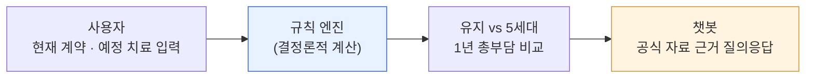
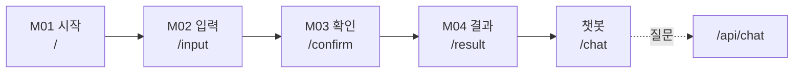
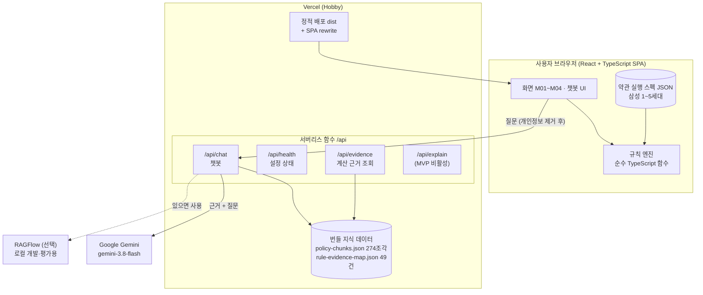
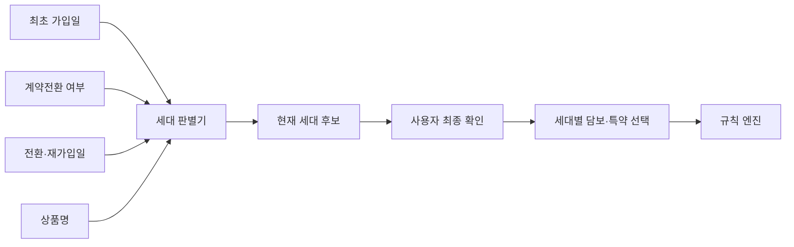
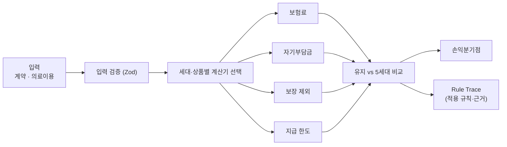
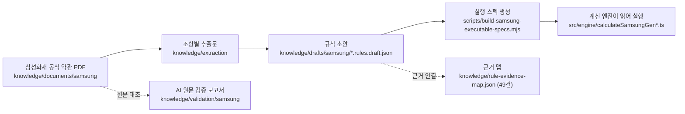
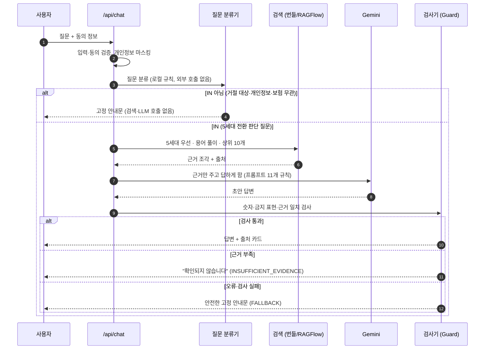
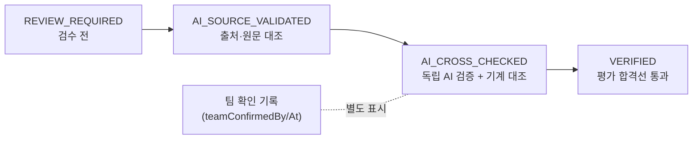
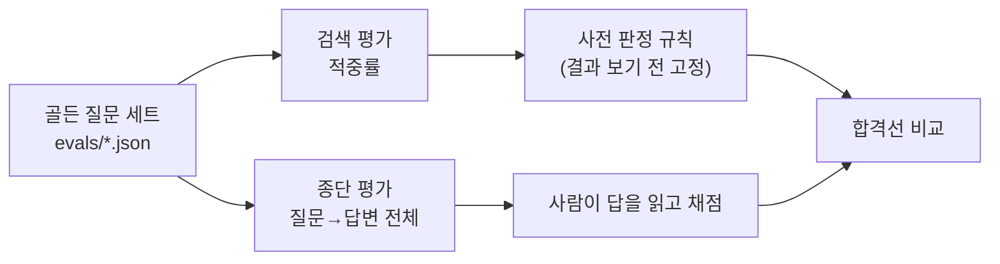

# AI 실손 닥터 — 프로젝트 전체 가이드

> 1~4세대 실손보험 가입자가 **"지금 보험을 유지할까, 5세대로 바꿀까"** 를 같은 조건에서 숫자로 비교하고, 궁금한 점을 **공식 자료 근거로 답하는 챗봇**에게 물어볼 수 있는 모바일 웹 서비스입니다.
>
> 이 문서는 **처음 보는 사람이 서비스의 목적 → 화면 → 구조 → 계산 → 챗봇 → 자료 → 검증 → 폴더 → 진행 과정 → 남은 일**을 순서대로 이해하도록 쓴 전체 가이드입니다. (기준일 2026-10-07)

## 목차

1. [한눈에 보기](#1-한눈에-보기)
2. [왜 만들었나](#2-왜-만들었나)
3. [서비스 둘러보기 — 화면과 기능](#3-서비스-둘러보기--화면과-기능)
4. [시스템 구조](#4-시스템-구조)
5. [계산 엔진](#5-계산-엔진)
6. [챗봇](#6-챗봇)
7. [근거 자료(지식) 체계](#7-근거-자료지식-체계)
8. [검증 — 무엇을 어떻게 확인했나](#8-검증--무엇을-어떻게-확인했나)
9. [알려진 한계](#9-알려진-한계)
10. [폴더 구조 — 어디에 무엇이 있나](#10-폴더-구조--어디에-무엇이-있나)
11. [실행·테스트·배포](#11-실행테스트배포)
12. [진행 과정 — 처음부터 지금까지](#12-진행-과정--처음부터-지금까지)
13. [남은 일](#13-남은-일)
14. [문서 지도](#14-문서-지도)
15. [용어 사전](#15-용어-사전)
16. [면책](#16-면책)

---

## 1. 한눈에 보기

| 항목 | 내용 |
|---|---|
| 한 줄 소개 | 실손보험 유지 vs 5세대 전환의 **1년 총부담**을 같은 조건으로 비교하고, 약관 근거 챗봇으로 궁금증을 해소 |
| 성격 | 금융 해커톤 출품작 (최종 제출 2026-10-08 10:00 / 발표 심사 10-13) |
| 대상 | 1~4세대 실손보험 가입자 (대표 상품: 삼성화재 1~5세대) |
| 형태 | React + TypeScript 모바일 우선 웹앱 + Vercel 서버리스 API |
| 핵심 원칙 | **숫자는 AI가 아니라 규칙 엔진이 계산한다.** AI는 설명과 질의응답만 한다 |
| 하지 않는 것 | 보험 가입 권유·판매, 진단, 보험금 확정 안내 |

서비스는 **세 부분**으로 이루어집니다.

| 부분 | 하는 일 | 핵심 기술 | 실행 위치 |
|---|---|---|---|
| ① 계약 확인 · 입력 | 보험사·가입일·상품·특약, 예정 치료 입력. 현재 세대를 판별 | 입력 폼, 세대 판별 | 브라우저 |
| ② 비교 계산 | 유지 vs 5세대 전환의 1년 총부담 계산, 손익분기점, 근거 추적 | 규칙 엔진(결정론적) | 브라우저 |
| ③ 질의응답 챗봇 | 전환 판단 질문에 공식 자료 근거로 답변 | RAG + Gemini + 검사기 | Vercel 서버리스 |

---

## 2. 왜 만들었나

실손보험은 1세대부터 5세대까지 약관이 달라서, 가입자는 "바꾸면 이득인지" 판단하기 어렵습니다. 5세대는 보험료가 내려가는 대신 자기부담금과 보장 범위가 달라지기 때문입니다.

AI 실손 닥터는 두 가지 질문에 답합니다.

1. **계산** — "같은 치료를 받는다면 1년 동안 내 총부담은 유지할 때와 전환할 때 각각 얼마인가?"
2. **이해** — "5세대로 바꾸면 줄어드는 보장이 있나요? 되돌릴 수 있나요?" 같은 일반 질문

연간 총부담은 아래 식으로 정의합니다.

```text
연간 총부담 = 연간 납입보험료 + 예상 자기부담금 + 보장 제외 의료비 − 실제 적용이 확인된 공식 할인
```



---

## 3. 서비스 둘러보기 — 화면과 기능

### 3-1. 사용자 여정



| 화면 | 경로 | 파일 | 하는 일 |
|---|---|---|---|
| M01 시작 | `/` | `src/pages/M01StartPage` | 서비스 소개("보험료뿐 아니라 달라지는 보장까지 비교하세요"), 1~5세대 변천사, 이용 3단계 안내 |
| M02 입력 | `/input` | `src/pages/M02InputPage` | 현재 계약(세대·상품·보험료·특약)과 예정 치료(여러 건) 입력. 샘플 증권 불러오기. 세대별 정밀 입력(2·3세대 상품 종형, 5세대 특약 등) |
| M03 확인 | `/confirm` | `src/pages/M03ConfirmPage` | 입력값 재확인 |
| M04 결과 | `/result` | `src/pages/M04ResultPage` | 유지 vs 5세대 비교, 보험료·자기부담·보장 제외·한도 초과, 손익분기 탐색, 계산 근거(Rule Trace), 세대 변천사, **PDF 저장** |
| 챗봇 | `/chat` | `src/features/chatbot` | 추천 질문 칩 + 자유 질문, 답변 카드, 출처 카드, 동의창 |

### 3-2. 기능 목록

| 기능 | 설명 | 상태 |
|---|---|---|
| 4단계 모바일 화면 | 시작 → 입력 → 확인 → 결과 | 구현 |
| 1~5세대 계산 | 삼성화재 1·2·3·4·5세대 약관을 규칙으로 구조화해 계산 | 구현(상태는 5·8장 참고: 초안 검산) |
| 유지 vs 5세대 비교 | 보험료 · 자기부담금 · 예상 보험금 · 보장 제외 · 한도 초과 | 구현 |
| 손익분기점 탐색 | 통원 횟수를 늘려 가며 어느 지점에서 총부담이 역전되는지 탐색(최대 120회) | 구현 |
| 계산 근거 추적 | 적용된 규칙을 Rule Trace로 표시 | 구현 |
| 결과 PDF 저장 | 결과 화면을 A4 PDF로 저장 (`html2canvas` + `jsPDF`) | 구현 |
| 약관 근거 챗봇 | 5세대 전환 판단 질문에 공식 출처와 함께 답변 | 구현(한계는 8·9장) |
| 범위 밖·개인정보 질문 거절 | 고정 안내문으로 응답, AI 호출 없음 | 구현 |
| 계산 결과 AI 설명 (`/api/explain`) | MVP에서는 비활성, 템플릿 설명 사용 | 후속 |
| 계산 근거 조회 (`/api/evidence`) | 서버는 준비됨. 현재 어느 화면도 호출하지 않음 | 서버만 구현 |

---

## 4. 시스템 구조

### 4-1. 전체 구성

계산은 **브라우저**에서, 챗봇은 **서버리스 API**에서 처리합니다. 서로 섞이지 않도록 일부러 분리했습니다.



**설계 포인트**

- 계산에 쓰는 입력(보험료·치료 정보 등)은 서버로 보내지 않습니다. 챗봇 서버에는 **질문 문장**과 동의 정보만 갑니다.
- 배포 환경에는 RAGFlow가 없어도 **저장소에 포함된 지식 데이터로 검색**하므로 챗봇이 동작합니다(`RETRIEVAL_MODE=auto`).
- LLM 호출이 실패하면 오류 화면 대신 **안전한 고정 안내문(FALLBACK)** 으로 응답합니다.

### 4-2. 기술 스택

| 영역 | 기술 |
|---|---|
| 프론트엔드 | React 19, TypeScript, Vite, React Router, React Hook Form + Zod, Zustand |
| 계산 | 순수 TypeScript 함수 + `decimal.js`(부동소수 오차 방지) |
| PDF 저장 | `html2canvas` + `jsPDF` |
| 서버 | Vercel Functions (`api/*.ts`, Web 표준 `Request`/`Response`) |
| LLM | Google Gemini (`gemini-3.8-flash`, thinking `low`) · 개발용 로컬 Ollama |
| 검색(RAG) | 배포: 번들 BM25(단어 + 한국어 bigram) / 개발·평가: RAGFlow(청크 256, 벡터 가중치 0.5) |
| 테스트 | Vitest (842개 통과) |
| 배포 | Vercel Git 연동 (`vercel.json`) |

### 4-3. 세대 판별 — 사용자가 세대를 추측하지 않게

세대를 잘못 고르면 자기부담률·공제액·한도가 모두 틀어집니다. 그래서 실제 계약 계산에서는 세대를 직접 고르게 하지 않고, **가입일 등으로 시스템이 판별한 뒤 사용자가 확인**하는 설계입니다(설계 문서 17·18번).



사용자에게 상품코드·자기부담률·공제액·한도·계산식을 묻지 않습니다. 이 값들은 검수된 내부 규칙이 가집니다. 샘플 체험과 세대별 설명 화면에서는 세대를 직접 선택할 수 있습니다.

---

## 5. 계산 엔진

### 5-1. 계산 흐름



- 같은 입력이면 **항상 같은 결과**(결정론적)입니다. AI가 숫자를 만들지 않습니다.
- 세대별 계산기 `calculateSamsungGen1~5`와 비교기 `calculateSamsungComparison`이 `src/engine/`에 있습니다.
- 금액은 `decimal.js`로 계산한 뒤 원(KRW) 정수로 변환합니다.

### 5-2. 상품과 규칙 구조

| 세대 | 대표 상품 코드 | 종형(variants) |
|---|---|---|
| 1 | `SAMSUNG_0904_2` | default |
| 2 | `SAMSUNG_1611_7` | standard(표준형), selected2(선택형Ⅱ) |
| 3 | `SAMSUNG_1704_1` | standard, selected2 |
| 4 | `SAMSUNG_2107_1` | default |
| 5 | `SAMSUNG_2605_1` | general(일반형), conversion(계약전환형) |

규칙이 만들어지는 과정은 다음과 같습니다.



- 규칙 후보는 **38개**이며, 원문 대조에서 8개를 보완하고 빠진 담보 6개를 추가했습니다(`AI_TERMS_VALIDATION_REPORT.md`).
- 근거 맵은 규칙을 **약관 문서·쪽수**와 연결합니다(삼성 5개 상품 49건).
- 테스트는 세대별 계산, 실행 스펙, 경계값, 손익분기, 근거 정합성을 검사합니다(`tests/samsung-*.test.ts` 등).

> **정직한 상태 표기**: 상품 카탈로그(`src/data/products.json`)의 검증 상태는 `REVIEW_REQUIRED`, `calculationEnabled: false`이고, 화면 라벨도 "상품별 실행 스펙 · **초안 검산**"입니다. AI 원문 대조는 완료했지만 **사람 검수와 운영 승인 전**이라는 뜻입니다. 계산 결과는 시연·모의 비교용이며 확정 보험금이 아닙니다.

---

## 6. 챗봇

### 6-1. 처리 흐름



### 6-2. 질문 분류 — 무엇에 답하고 무엇을 거절하나

| 분류 | 의미 | 처리 |
|---|---|---|
| **IN** | 5세대 전환 판단·세대 비교 질문(15가지 유형) | 근거 검색 → AI 답변 |
| OUT-01 | 가입·전환을 권유해 달라는 질문 | 고정 안내문 |
| OUT-02 ~ 04 | 확정 보험금, 의료 선택 상담 등 | 고정 안내문 |
| PRIVACY (OUT-05) | 이름·증권번호 등 개인정보 | 고정 안내문, 값은 서버에 전달 안 함 |
| OUT-DOMAIN | 보험과 무관 | 고정 안내문 |

분류는 **로컬 규칙만** 사용합니다. 애매하면 허용하지 않고 안전한 쪽(거절)으로 보냅니다.

### 6-3. 검색(Retrieval)

| 설정 | 값 |
|---|---|
| 5세대 우선 | 질문이 1~4세대·세대 비교를 묻지 않으면 5세대 자료만 검색 |
| 용어 풀이 | "싼·줄일" → "저렴 인하" 처럼 일상어를 문서 용어로 확장 |
| 상위 N / 하한 | 상위 10개, 유사도 0.1 이상 |
| 모드 | `auto`(RAGFlow 있으면 사용, 없으면 번들) / `ragflow` / `bundled` |
| 번들 검색 | `api/_data/policy-chunks.json` 274조각을 BM25(단어 + 한국어 bigram)로 검색 |

### 6-4. 안전장치

| 장치 | 역할 |
|---|---|
| 질문 분류기 | 범위 밖·개인정보 질문을 AI에 보내지 않고 차단 |
| 개인정보 마스킹 | 식별 정보가 서버 로그·LLM으로 가지 않도록 처리 |
| 동의 검증 | 동의 버전(`ai-chat-1.0`)이 맞지 않으면 거부 |
| 외부 AI 이용 안내 | 동의창에서 Google Gemini API로 전달·해외 처리 가능·무료 약관상 서비스 개선 사용 가능·서버 미저장·개인정보 입력 금지를 안내 |
| 호출 횟수 제한 | LLM을 부르는 질문에 한해 IP당 분당 10회, 전체 하루 500회 초과 시 `429`. 서버 함수 메모리 기반 안전망(`api/_lib/rateLimit.ts`) |
| 프롬프트 규칙 11개 | "근거에 있는 것만", "예정·예시 숫자 금지", "추천 금지", "조건·방향 유지" 등 |
| 답변 검사기 (Guard) | 근거에 없는 숫자, 단정·추천·비교 우위 표현 차단 |
| 근거 부족 구분 | 출처 없음 + "확인되지 않습니다" → 별도 상태로 표시 |
| 장애 대응 | RAG·LLM 오류, 키 오류, 시간 초과 → 고정 안내문 (장애 시험 5종 통과) |

### 6-5. 개인정보와 보안

| 항목 | 내용 |
|---|---|
| 외부로 나가는 정보 | 챗봇 질문 중 IN으로 분류된 일반 질문만 Gemini API로 전달합니다. STEP 1~5 입력값과 계산 결과는 전달하지 않습니다 |
| 서버 저장 | 질문 내용을 저장하지 않습니다(별도 DB·파일 기록 없음). 계산은 브라우저에서 수행합니다 |
| 운영 로그 | `api/_lib/requestLog.ts`가 요청마다 요청 ID, 처리 결과(ANSWERED·FALLBACK·RATE_LIMITED 등), HTTP 상태, 처리 시간만 한 줄(JSON) 기록합니다. 질문 원문·답변·개인정보는 남기지 않으며, 오류율·거절 비율·한도 초과를 Vercel 함수 로그에서 확인하는 용도입니다. 보관 기간은 Vercel 플랫폼 정책을 따릅니다 |
| 무료 키의 조건 | [Gemini API 약관](https://ai.google.dev/terms)상 무료(Unpaid) 서비스의 입력·출력은 Google의 제품 개선에 쓰이고 사람 검토자가 읽을 수 있습니다. 유료 서비스는 이런 용도로 쓰지 않습니다 |
| 대응 | 개인정보 질문 차단, 마스킹, 동의창 안내와 "개인정보·치료정보 입력 금지" 문구. 실제 고객 정보를 받는 운영 단계에서는 유료 키 전환이 필요합니다 |
| 키 관리 | 비밀값은 서버 함수에서만 `process.env`로 읽고 `VITE_` 접두어를 쓰지 않습니다. `.env.local`은 git에서 제외하고, Vercel에서는 `LLM_API_KEY`를 Sensitive 값으로 저장합니다 |
| 디버그 | `CHAT_DEBUG=1`이면 응답에 내부 오류 내용이 담기므로 운영 환경에는 설정하지 않습니다 |

동의창 문구:

> 입력한 일반 질문은 답변 생성을 위해 외부 AI 서비스(Google Gemini API)로 전달되며, 해외 서버에서 처리될 수 있습니다. 무료 서비스 약관에 따라 질문 내용은 Google의 서비스 개선에 사용될 수 있습니다. 이 서비스는 질문 내용을 서버에 저장하지 않습니다.
> 이름·연락처·병원·진단명 등 개인정보와 치료정보는 질문에 입력하지 마세요.

---

## 7. 근거 자료(지식) 체계

### 7-1. 두 종류의 자료

| 구분 | 용도 | 위치 |
|---|---|---|
| **삼성화재 약관** (1~5세대 공식 PDF 5개) | **계산 규칙의 근거** (챗봇 RAG 근거 아님) | `knowledge/documents/samsung/` |
| **정책 자료** (금융위·금감원·손해보험협회 등 15개) | **챗봇 일반 질문의 근거 (RAG)** | `knowledge/documents/fsc/` |

정책 자료 폴더 구성:

| 폴더 | 내용 |
|---|---|
| `A_5세대_핵심` | 금융위 5세대 보도자료·Q&A·인포그래픽, 손보협회 5세대·계약전환 안내 |
| `B_세대비교` | 1~4세대 출시·특징 자료, **INS-01(5세대 약관 3사 비교 요약)** |
| `C_참고_업로드안함` | 참고용(계획·논의·입법예고 등). **RAG에 넣지 않음** |
| `D_표준_근거확인용` | 표준약관 발췌 (확인용, 업로드 안 함) |
| `E_약관원문_INS01근거` | INS-01 요약의 원문(KB손보·신한 약관) |

선정 원칙: **출시·시행된 확정 문서만** 사용합니다. 계획·논의·입법예고 문서는 제외하고, 5세대 중 시행 전 제도는 "시행 전"으로 표시합니다.

### 7-2. 문서 신뢰 단계

문서와 규칙에는 신뢰 단계가 있고, 서버는 **허용한 단계의 자료만** 검색합니다(`RAG_ALLOWED_STATUS`).



현재 RAG 정책 자료 15개는 모두 **`AI_CROSS_CHECKED`** 입니다. `VERIFIED`는 평가 합격선을 넘지 못해 **일부러 올리지 않았습니다**(8장).

### 7-3. 메타데이터

문서마다 `documentId`, `title`, `publisher`, `sourceUrl`(공식 출처 주소), `publishedAt`, `verifiedAt`, `version`, `status`를 기록합니다.
정책 자료는 `knowledge/metadata/policy/policy-docs.json`, 삼성 약관은 `knowledge/metadata/samsung/`와 `knowledge/manifest.json`(파일 해시 SHA-256 포함)에 있습니다.

---

## 8. 검증 — 무엇을 어떻게 확인했나

> 이 서비스의 가장 큰 위험은 **틀린 답**입니다. 그래서 점수를 좋게 보이게 하기보다 모자란 점을 그대로 적습니다.

### 8-1. 검증 방법



- **사전 판정 규칙**: 결과를 보기 전에 합격선을 정합니다.
- **독립 질문 세트**: 튜닝에 쓰지 않은 새 질문(holdout)으로 과적합을 확인합니다.
- 질문 세트: dev 40문항, final 31문항(1회 사용), holdout2 30문항, 팀 확정 IN 15문항.

### 8-2. 결과

| 평가 | 결과 | 판정 |
|---|---|---|
| 검색 적중률 dev 40문항 | 85.0% (합격선 90%) | **미달** |
| 검색 적중률 final 31문항 (1회 사용) | 83.9% (합격선 85%) | **미달** |
| 번들 검색 holdout2 30문항 | 96.7% (단, top-3는 약 70~80%) | 참고용 |
| Gemini 종단 평가 holdout2 30문항 | 답변 23 / 불가 7, 읽고 채점한 정확 20/23 | 30문항 전체 기준 정확 약 67% |
| Gemini 종단 평가 팀 확정 IN 15문항 | 정확 8 · 불완전 3 · 근거 부족 2 · 검사 차단 2, **사실 오류 0** | 정확 8/15 (53%) |

### 8-3. 해석

- 위험은 "틀리게 말하는 것"보다 **"답하지 못하는 것"** 쪽에 있습니다. 근거가 없으면 지어내지 않고 "확인되지 않습니다"로 끝납니다.
- 약한 질문: 보험료 줄이는 방법, 세대 구분·세대 비교, 전환 신청 절차 일부.
- 검색 적중률은 "상위 10개 중 하나라도 맞으면 적중"이라 **낙관적**입니다. 평가 질문도 실패 패턴을 본 사람이 만들어 낙관적일 수 있습니다.
- 검사기(Guard)는 숫자·금지 표현만 보고 **의미 오류는 잡지 못합니다.** 시연 전 사람이 답변을 읽고 확인합니다.
- 합격선 미달이므로 `VERIFIED`로 올리지 않았습니다.

### 8-4. 계산 쪽 검증

- 삼성화재 약관 5개를 쪽별 원문과 대조해 규칙을 검증했고(AI 원문 검증), 결과 보고서가 `knowledge/validation/samsung/`에 있습니다.
- 계산 관련 자동 테스트: 세대별 계산, 실행 스펙 정합성, 경계값, 손익분기, 근거 맵 정합성 등 (전체 842개 통과, 2026-10-07 기준).

---

## 9. 알려진 한계

발표·시연 전에 꼭 알아둘 것입니다.

| 한계 | 영향 | 대응 |
|---|---|---|
| Gemini 무료 한도(분당 5건, 하루 20건)와 간헐적 503 | 시연 중 답변 실패 가능 | 시연 방식(배포/라이브/녹화)과 요금제 결정 필요, 실패 시 고정 안내문 |
| 계산 규칙은 AI 원문 검증까지만 완료 | "초안 검산" 상태, 확정 보험금 아님 | 화면 고지, 사람 검수·승인은 후속 |
| 챗봇은 상품 필터 없이 동작 | 삼성 외 상품을 구분하지 못함 | 한계 문장으로 안내 |
| 일부 질문은 근거 부족으로 답하지 못함 | "확인되지 않습니다" 표시 | 시연 질문을 검증된 것으로 선정(`19e`) |
| 2026.11 시행 예정 제도(선택형 할인 등) | 시행 전 정보 | "시행 전" 표시, 출시 후 갱신 필요 |
| `/api/health`가 배포에서 `degraded`로 보일 수 있음 | RAGFlow 미설정이 원인이며 정상 | 번들 검색으로 챗봇은 동작 |
| 1·2세대 약관은 RAG에 없음 | 해당 세대 상세 질문 한계 | 후속 과제 |
| 계산 결과 AI 설명 비활성 | 템플릿 설명 사용 | 후속 |
| 무료 Gemini 키 사용 | 질문 내용이 Google의 서비스 개선에 쓰일 수 있음 | 동의창 안내, 개인정보 입력 금지 안내. 실제 고객 대상 운영 시 유료 키 전환(6-5) |
| 호출 횟수 제한은 서버 메모리 기반 | 인스턴스가 여러 개이거나 재시작되면 기록이 나뉨 | 비용 폭주를 막는 안전망으로만 사용, Google 쿼터가 최종 한도 |

---

## 10. 폴더 구조 — 어디에 무엇이 있나

```text
AI_IHID/
├─ README.md                  서비스 한 줄 소개와 Health API 계약
├─ index.html · vite.config.ts · vercel.json · package.json · tsconfig*.json
│
├─ src/                       ── 프론트엔드 (브라우저)
│  ├─ main.tsx · App.tsx
│  ├─ app/router.tsx          경로: / /input /confirm /result /chat
│  ├─ pages/                  M01 시작 · M02 입력 · M03 확인 · M04 결과
│  ├─ features/
│  │  ├─ chatbot/             챗봇 화면(ResultChatbot, 답변·출처 카드, 질문 칩)
│  │  └─ calculation/         계산 결과 조각(근거 패널, 상품 선택, 상세 내역)
│  ├─ components/             공통 셸, 입력 도움말, samsung/ 세대별 입력·결과
│  ├─ engine/                 규칙 엔진(세대별 계산기, 비교, 손익분기, Rule Trace)
│  ├─ rules/                  samsung/ 세대별 규칙 JSON, legacy/ 초기 MVP 규칙
│  ├─ domain/                 타입 정의(계약, 의료이용, 상품, 계산 결과)
│  ├─ services/               계산·API 호출·샘플 서비스
│  ├─ store/                  Zustand 상태(useAnalysisStore)
│  ├─ data/                   상품 카탈로그, 폴백 문구, 지식 팩
│  └─ samples/                샘플 증권
│
├─ api/                       ── 서버리스 함수 (Vercel)
│  ├─ chat.ts                 챗봇 (분류→검색→LLM→검사)
│  ├─ evidence.ts             계산 근거 조회
│  ├─ explain.ts              계산 결과 AI 설명 (MVP 비활성)
│  ├─ health.ts               설정 상태 확인
│  ├─ lib/                    분류기, 검색(번들·RAGFlow), 프롬프트, 검사기,
│  │                          LLM 호출, 개인정보 마스킹, 동의 검증, 호출 횟수 제한, 설정
│  └─ data/policy-chunks.json 번들 검색용 지식 조각(274)
│
├─ knowledge/                 ── 근거 자료와 검증 기록
│  ├─ documents/              samsung/(약관 PDF) · fsc/(정책 자료 A~E)
│  ├─ metadata/               문서별 출처·상태 메타데이터
│  ├─ extraction/             약관 조항별 추출문
│  ├─ drafts/samsung/         규칙 초안 · 실행 스펙 · 규칙 마스터(엑셀)
│  ├─ validation/             AI 원문 검증 보고서, 검색·종단 평가 결과
│  ├─ rag-corpus/             RAG용 정리본
│  ├─ rule-evidence-map.json  규칙 ↔ 약관 쪽수 연결(49건)
│  ├─ manifest.json           문서 파일명·해시·출처
│  └─ question-scope.json · retrieval-evaluation.json · product-selection.md
│
├─ evals/                     ── 평가 질문과 종단 평가 도구
│  ├─ golden-questions.json · golden-holdout2.json · golden-team-in15.json
│  └─ e2e/                    종단 평가 실행기(run.e2e.ts 등)
│
├─ scripts/                   ── 보조 도구 (RAGFlow 메타데이터, 평가, 실행 스펙 생성, 운영 점검)
├─ tests/                     ── Vitest 테스트 (68개 파일, 전체 842개 테스트는 api 테스트 포함)
├─ local/viteApiPlugin.ts     개발 서버가 /api를 흉내 내는 플러그인
├─ policies/                  개인정보·보안 정책
├─ handoff/                   단계 간 인수인계 JSON
└─ docs/                      이 문서, 화면 미리보기, 검증 메모
```

문서·계획·실험 기록은 저장소 밖 `금융 프로젝트/docs/ai-silson-doctor/`에 있습니다(14장).

---

## 11. 실행·테스트·배포

### 11-1. 로컬 실행

```bash
npm install
```

```bash
npm run dev
```

```bash
npm test
```

```bash
npm run build
```

챗봇을 로컬에서 쓰려면 프로젝트 루트에 `.env.local`(git 제외)을 만들어 아래 이름의 값을 넣습니다. **키 값은 절대 저장소에 올리지 않습니다.**

| 환경변수 | 용도 | 값 |
|---|---|---|
| `LLM_API_KEY` | Gemini 키 | (비밀) |
| `LLM_MODEL` | 모델 | `gemini-3.8-flash` |
| `LLM_THINKING_LEVEL` | 추론 수준 | `low` |
| `CHAT_TIMEOUT_MS` | 응답 대기 시간(ms) | `45000` |
| `CHAT_CONSENT_POLICY_VERSION` | 동의 버전 | `ai-chat-1.0` |
| `CHAT_RATE_LIMIT_PER_MIN` | IP당 분당 질문 수(선택) | 비우면 `10` |
| `CHAT_DAILY_LIMIT` | 전체 하루 질문 수(선택) | 비우면 `500` |
| `RAG_ALLOWED_STATUS` | 검색 허용 신뢰 단계 | `VERIFIED,AI_CROSS_CHECKED,AI_SOURCE_VALIDATED` |
| `CHAT_DEBUG` | 평가용 디버그 응답. **운영에서는 설정하지 않음** | (비움) |
| `RETRIEVAL_MODE` | 검색 방식 | `auto`(기본) / `ragflow` / `bundled` |
| `RAGFLOW_*` | RAGFlow 연결(선택) | 배포에서는 비워 둠 |

### 11-2. Vercel 배포

1. GitHub 저장소를 Vercel에서 Import (Framework: Vite, Production Branch: `main`)
2. 환경변수 입력 (위 표에서 `RAGFLOW_*` 제외, 키는 Vercel 입력창에 직접)
3. Deploy → 배포 주소에서 `/api/health`와 챗봇 질문으로 확인

> Vercel은 `api/` 함수의 `default export`가 `fetch` 속성을 가진 형식이어야 인식합니다. 이 저장소는 `Object.assign(handler, { fetch: handler })`로 호환시켰고, 로컬 개발 서버와 테스트는 기존 호출 방식을 그대로 씁니다. (PR #29)

`vercel.json`: 챗봇 함수 최대 실행 120초, `/api`를 제외한 모든 경로를 `index.html`로 보내는 SPA rewrite.

### Vercel 무료(Hobby) 플랜 운영 메모

이 서비스는 **무료(Hobby) 플랜**으로 배포합니다. 아래 조건을 지켜야 합니다.

| 제약 | 이 저장소의 대응 |
|---|---|
| 서버리스 함수는 배포당 **최대 12개** | `api/` 안의 `.ts` 파일은 **모두 함수 1개로 계산**됩니다. 도우미 코드는 이름이 `_`로 시작하는 폴더(`api/_lib`, `api/_data`)에 두어 함수로 세지 않게 했습니다. 함수는 `chat`, `evidence`, `explain`, `health` 4개뿐입니다 |
| 함수 최대 실행 시간 | `vercel.json`에서 챗봇 120초로 설정(Hobby 한도 300초 이내). 챗봇 자체 대기는 45초(`CHAT_TIMEOUT_MS`) |
| 비상업용 | 공모전 시연 용도로만 사용 |
| 주의: 새 파일을 `api/` 바로 아래에 만들지 않기 | 새 도우미 파일은 반드시 `api/_lib/`에 둡니다. 안 그러면 함수 개수가 늘어 배포가 막힙니다 |
| Production 주소는 공개, Preview 주소는 로그인 보호 | 심사·시연용으로는 Production(`main`) 주소를 사용 |

### 11-3. 로컬 RAGFlow (선택, 개발·평가용)

검색 품질 실험은 이 Mac의 Docker(RAGFlow) + Ollama(임베딩 `embeddinggemma`, LLM `gemma3:12b`)로 했습니다. 배포에는 필요 없습니다. 자세한 방법은 `15a_local_ragflow_ollama_quick_guide.md`.

---

## 12. 진행 과정 — 처음부터 지금까지

| 시기 | 한 일 |
|---|---|
| **1. 기획 (9/5)** | 요구사항·와이어프레임·ERD·API·아키텍처·기술 스택 정의(01~08번 문서). 2일 안에 만들 **정적 SPA MVP**로 범위를 좁힘(서버·DB·외부 AI 없음) |
| **2. MVP 구현 (9/5~9/7)** | 시작·입력·확인·결과 4개 화면, 유지 vs 5세대 비교 엔진, 손익분기, PDF 저장, 세대 변천사 카드, 모바일 입력 개선 (PR #1~#4) |
| **3. 본선 설계 (9/23~9/27)** | 본선 시스템 아키텍처·챗봇 구현 명세·개발자 전달 문서(09~13). 챗봇 API를 도입하고 LLM을 Gemini로 이전, 계산 근거·설명 아키텍처 추가 (PR #5~#11) |
| **4. 약관 규칙 검증 (9/28~9/30)** | 삼성화재 1~5세대 공식 약관 PDF 5개를 쪽별로 원문 대조(38개 규칙, 8개 보완·6개 추가). 세대별 실행 스펙을 만들어 계산 엔진에 연결 (PR #12~#22) |
| **5. RAG 구축·실험 (9/30~10/3)** | 로컬 RAGFlow + Ollama로 약관·정책 자료 검색 실험(청크 크기·파서·임베딩·가중치). 근거 맵 방식 도입(표·한도 질문은 규칙 근거 직접 조회, 일반 질문만 RAG) |
| **6. 화면·계산 보강 (9/30~10/4)** | 세대·건강보험 자기부담 자동 입력, 다중 치료 슬롯, 5세대 입력 검증, 손익분기 탐색 확장, 계산 검증 강화 (PR #23~#26) |
| **7. 챗봇 완성 (10/3~10/4)** | 챗봇 범위 확정(IN 15 / OUT 5), 정책 자료 15개 등록·출처 확정, 질문 분류기·고정 안내문, 검사기(Guard), 번들 검색(RAGFlow 없이도 배포 가능), Gemini 종단 평가 (PR #28) |
| **8. 배포 준비 (10/4)** | Vercel이 `api/` 함수를 인식하도록 호환 수정(PR #29), `main` 병합 후 Vercel 연결 진행 |

### 주요 설계 결정과 이유

| 결정 | 이유 |
|---|---|
| 계산은 AI가 아닌 결정론적 규칙 엔진 | 같은 입력 → 같은 결과, 근거 추적 가능, 환각 위험 제거 |
| 챗봇 답변은 근거 부족하면 "확인되지 않습니다" | 지어낸 답이 가장 위험하기 때문 |
| 범위 밖·개인정보 질문은 AI를 거치지 않고 고정 안내문 | 안전·개인정보 보호, 비용 절감 |
| 문서 상태를 `VERIFIED`로 올리지 않음 | 평가 합격선 미달을 숨기지 않기 위해 |
| 배포용 번들 검색 도입 | 시연 환경에 RAGFlow 서버를 둘 수 없어서 |
| 약관은 계산 근거, 정책 자료는 챗봇 근거로 분리 | 표·한도는 규칙으로, 설명·절차는 RAG로 각각 강점 활용 |
| 중국계 모델 사용 금지(로컬 실험) | 정책 결정 — 임베딩 `embeddinggemma`, LLM `gemma3:12b` 사용 |

### 팀 작업 방식

- 브랜치: `feature/work_M`(챗봇·RAG·규칙 검증), `feature/work_K`·`feature/work_soyul`(화면·계산 입력 UX) 등에서 작업 후 `develop`으로 PR → 병합, 마지막에 `main`으로 반영합니다.
- 화면(`src/`)은 화면 담당 팀원이 주도하고, 챗봇·서버(`api/`)·지식(`knowledge/`)·평가(`evals/`)는 챗봇 담당이 맡았습니다.

---

## 13. 남은 일

| 우선순위 | 일 |
|---|---|
| 1 | 배포 환경에서 챗봇 동작 확인 (진행 중: `main` 병합 완료, Vercel 연결) |
| 2 | 서비스 화면 다듬기 (화면 담당 주도) |
| 3 | 계산 결과의 약관 근거 맵을 화면에 연결 (배치 결정 후) |
| 4 | 시연 방식·Gemini 요금제 결정, 약한 질문 보강, 제출 서류·파일 정리, 코드 동결 시점 정하기 |
| 후속 | 1·2세대 약관 RAG 등록, 120문항 평가, 계산 규칙 사람 검수·`VERIFIED` 승격, 시행 예정 제도 갱신, `/api/explain` 활성화 |

---

## 14. 문서 지도

프로젝트 기록은 저장소 밖 `금융 프로젝트/docs/ai-silson-doctor/`에 번호순으로 있습니다.

| 번호 | 문서 | 내용 |
|---|---|---|
| 01 | requirements | 요구사항 (MVP 포함·제외 범위, 핵심 업무 규칙) |
| 02 | wireframes | 와이어프레임 (390×844 모바일 기준) |
| 03 | erd | ERD·데이터 사전 (후속 DB 설계) |
| 04 | api_spec | API 명세 (후속 백엔드 계약) |
| 05 | service_architecture | 서비스 아키텍처 (MVP → B2B2C 확장 구조) |
| 06 | technology_stack | 기술 스택 정의 |
| 07 | change_notice_for_developers | 개발 변경명세 |
| 08 | consolidated_mvp_spec | 2일 MVP 통합 설계서 |
| 09 | final_round_system_architecture | 본선 시스템 아키텍처·데이터 흐름 |
| 10 | chatbot_implementation_spec | 본선 챗봇 구현 명세 |
| 11 | final_round_developer_handoff | 본선 개발자 전달용 통합 명세 |
| 12 | final_product_based_rag_llm_implementation_plan | 전체 실행 계획·진행관리표 |
| 13 | google_ai_studio_gemini_beginner_implementation_guide | Gemini 연결·최종 통합 작업지시서 |
| 14 | samsung_terms_1_to_5_beginner_usage_guide | 삼성화재 1~5세대 약관 정리·검수 |
| 15 / 15a / 15b | ragflow_standalone / local_ragflow_ollama_quick_guide / local_rag_experiment_log | RAGFlow 구축·검색 검증, 로컬 실행 가이드, 실험 기록 |
| 16 | samsung_rule_engine_typescript_implementation_and_testing_guide | 규칙 엔진 구현·테스트 |
| 17 | generation_1_to_5_user_selection_and_rule_engine_input_guide | 1~5세대 사용자 선택·엔진 입력 설계 |
| 18 | generation_date_resolution_and_screen_application_guide | 가입일 기반 세대 판별·화면 적용 |
| 19 | chatbot_master_guide | **챗봇 기준 문서**(스코프·흐름·지식원) |
| 19 부록 | appendix_qa_review_pack | 질문·답변·근거 검증 자료집 |
| 19a / 19b | work_orders / experiment_and_progress_log | 챗봇 작업지시서 / 실험·진행 기록 |
| **19c** | current_status | **지금 상태** (매일 처음 보는 문서) |
| 19d | human_review_and_source_url_guide | 사람 검수·출처 주소 교체 방법 |
| 19e | demo_and_submission_checklist | 시연·제출 점검표 |
| 19f | handoff_to_screen_teammate | 화면 담당 팀원 전달 사항 |

**읽는 순서 제안**: 이 문서 → 01 요구사항 → 05 아키텍처 → 19 챗봇 종합 → 19c 현재 상태 → 필요한 세부 문서.

---

## 15. 용어 사전

| 용어 | 뜻 |
|---|---|
| 실손의료보험(실손) | 실제 쓴 의료비를 보상하는 보험. 1~5세대로 약관이 다름 |
| 5세대 | 2026년 도입된 새 실손. 보험료 인하, 자기부담·보장 구조 변경, 이전 계약으로의 복귀 규정 등이 있음 |
| 계약전환 | 기존 세대 계약을 5세대로 바꾸는 것 |
| 자기부담금 | 의료비 중 가입자가 직접 내는 부분 |
| 보장 제외 | 보험이 보상하지 않는 의료비 |
| 손익분기점 | 유지와 전환의 총부담이 같아지는 의료 이용 수준 |
| 규칙 엔진(Rule Engine) | 약관 규칙을 코드로 실행해 금액을 계산하는 프로그램 |
| Rule Trace | 어떤 규칙이 적용돼 이 숫자가 나왔는지 남기는 근거 기록 |
| RAG | 질문과 관련된 자료 조각을 먼저 찾아 AI에게 근거로 주고 답하게 하는 방식 |
| 청크 | RAG를 위해 문서를 잘게 나눈 조각 |
| BM25 | 단어 일치를 기반으로 관련 조각을 찾는 검색 점수 방식 |
| RAGFlow | RAG용 문서 등록·검색 도구(로컬 Docker로 실험에 사용) |
| Guard(검사기) | AI 답변의 숫자·금지 표현·근거 일치를 검사하는 장치 |
| IN / OUT | 챗봇이 답할 질문(IN)과 고정 안내문으로 거절할 질문(OUT) |
| FALLBACK | 오류 시 보여 주는 안전한 고정 안내문 |
| 골든셋 | 정답 기준이 있는 평가용 질문 모음 |
| holdout | 튜닝에 쓰지 않은 독립 평가 질문 세트 |
| 종단(E2E) 평가 | 질문 입력부터 최종 답변까지 전 과정을 평가 |
| VERIFIED | 평가 합격선을 통과한 최고 신뢰 단계 (아직 없음) |

---

## 16. 면책

이 서비스는 **공모전 시연용**입니다. 입력한 조건에서의 약관 기반 **모의 비교**이며 보험 가입·유지·전환을 권유하지 않습니다. 실제 보험금과 보험료는 보험사와 계약 약관에 따라 달라질 수 있으므로, 최종 판단 전 보험사에 확인하시기 바랍니다.
